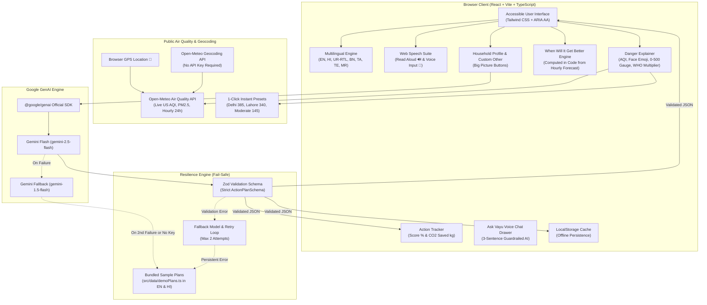

# VayuShield 🛡️
> **Accessible, Multilingual GenAI Urban Air Quality Assistant for Families During Winter Smog**  
> Translates live atmospheric pollution data into simple, actionable daily protection plans designed for everyone, including families with low reading ability.

[](https://github.com)
[](#-language-support)
[](https://www.w3.org/WAI/standards-guidelines/wcag/)
[](https://aistudio.google.com)
[](LICENSE)

---

## 📋 Table of Contents
- [Executive Overview](#-executive-overview)
- [System Architecture](#-system-architecture)
- [Simplicity & Multilingual Design](#-simplicity--multilingual-design)
- [Key Features](#-key-features)
- [Danger Explainer & Visual Gauge](#-danger-explainer--visual-gauge)
- ["When Will It Get Better" Engine](#-when-will-it-get-better-engine)
- [Resilience & Fail-Safe Strategy](#-resilience--fail-safe-strategy)
- [Algorithmic Weighting & Calculations](#-algorithmic-weighting--calculations)
- [Accessibility Compliance (WCAG AA)](#-accessibility-compliance-wcag-aa)
- [Project Structure](#-project-structure)
- [Getting Started](#-getting-started)
- [Testing & Quality Verification](#-testing--quality-verification)
- [Deployment Guide](#-deployment-guide)
- [Security & Production Architecture](#-security--production-architecture)
- [Limitations & Medical Disclaimer](#-limitations--medical-disclaimer)

---

## 🌟 Executive Overview

During North Indian and South Asian winters (e.g. Delhi NCR, Lahore, Kolkata, Dhaka), the **planetary boundary layer contracts**, creating thermal inversions that trap ultra-fine particulate matter ($PM_{2.5}$ and $PM_{10}$) within 100 meters of the ground. 

Most public air quality applications simply report alarming numbers (e.g. *"AQI 450: Hazardous"*), leaving families unsure when to aerate homes, which masks actually work, or how to protect vulnerable infants, elderly grandparents, or asthmatic family members.

**VayuShield** makes smog protection accessible to everyone:
1. **The #1 Most Important Thing To Do Today**: A bold, single-sentence hero action at the very top.
2. **Danger Explainer**: Prominent AQI number, big face emoji (😊 😐 😷 🤢 🚨 ☠️), 0-500 visual gauge, WHO $PM_{2.5}$ multiplier, and traffic light (🟢 safe, 🟡 be careful, 🔴 danger).
3. **"When Will It Get Better" Engine**: Computed in code from hourly forecasts, detailing the safest window (e.g. "Best time to go out: 2 PM to 4 PM"), evening inversion times, and browser reminder alerts.
4. **Multilingual & Native Scripts**: Instant switching between English, हिन्दी, اردو (RTL layout), বাংলা, தமிழ், తెలుగు, and मराठी.
5. **Simplicity for Low-Literacy Users**: Big picture buttons, 🔊 **Read Aloud** speech synthesis, 🎤 **Voice Input** dictation, Large Text mode, and clear Do ✅ / Don't ❌ comparison cards.
6. **Custom "Other" Support**: Users can specify any custom vulnerability (e.g. pregnancy, heart patient, pets), custom stove, or custom commute mode.

---

## 🏛️ System Architecture



---

## 🌐 Language Support

VayuShield provides native translations and Gemini generation across 7 South Asian regional languages:

| Code | Native Script | Language | Direction | Speech Synthesis Code |
|---|---|---|---|---|
| `en` | **English** | English | Left-to-Right | `en-US` |
| `hi` | **हिन्दी** | Hindi | Left-to-Right | `hi-IN` |
| `ur` | **اردو** | Urdu | **Right-to-Left (RTL)** | `ur-PK` |
| `bn` | **বাংলা** | Bengali | Left-to-Right | `bn-IN` |
| `ta` | **தமிழ்** | Tamil | Left-to-Right | `ta-IN` |
| `te` | **తెలుగు** | Telugu | Left-to-Right | `te-IN` |
| `mr` | **मराठी** | Marathi | Left-to-Right | `mr-IN` |

*The app remembers the chosen language in `localStorage` and automatically sets `<html lang="..." dir="...">`.*

---

## ⚡ Key Features

| Capability | Implementation Detail |
|---|---|
| **⭐ The #1 Action Today** | Hero banner showing the single most vital action for today (e.g. *"Keep windows closed until 2 PM"*). |
| **Danger Explainer** | Large AQI number, category label, big face emoji (😊 😐 😷 🤢 🚨 ☠️), 0-500 visual gauge, WHO multiplier, traffic light (🟢 🟡 🔴). |
| **"When Will It Get Better"** | Algorithmic forecast analysis calculating the best window, evening inversion spike, countdown, and 1-click notification reminder. |
| **🔊 Read Aloud Speech** | Web Speech API synthesis reading the daily briefing and routine aloud in the chosen language. |
| **🎤 Voice Input Chat** | Web Speech Recognition allowing hands-free questions in the "Ask Vayu" chat drawer. |
| **Custom "Other" Options** | Support for user-defined vulnerabilities (e.g. pregnancy, heart disease, pets) and custom stove/commute types. |
| **Offline Data Caching** | Last successful plan saved in `localStorage`; opens offline with *"Showing saved data from [time]"* banner. |
| **Visual Mask Guide** | Direct comparison: N95/FFP2 (works ✅) vs. Cloth/Surgical (fails ❌). |
| **Doctor Warning Box** | Emergency signs: chest pain, severe shortness of breath, continuous wheezing, bluish lips. |
| **Do ✅ & Don't ❌ Cards** | High-contrast, easy-to-follow behavioral lists. |
| **1-Click Presets & GPS** | Delhi Severe Smog (385), Lahore Hazardous (340), Moderate Haze (145), and GPS location detection. |
| **Action & Protection Tracker** | Transparent scoring: Protection Score (0–100%) and Daily $CO_2$ Saved (kg). |
| **One-Click Share Card** | WhatsApp direct share (`wa.me/?text=...`), clipboard copy, and `.txt` card export. |

---

## 🛡️ Resilience & Fail-Safe Strategy

The application guarantees that the user will **never see a broken screen**:
1. **No Key Provided**: Seamlessly boots with bundled sample plans (`src/data/demoPlans.ts`, in English and Hindi) and displays a distinct **Demo Mode** indicator.
2. **Network or Quota Failure**: If a live Gemini request fails, the engine retries once using the fallback model (`gemini-1.5-flash`). If both attempts fail, it automatically toggles to Demo Mode.
3. **Zod Schema Mismatch**: If Gemini's JSON response fails schema validation, the system retries with adjusted parameters, falling back safely to bundled plans if the error persists.
4. **Offline Persistence**: Successful plans are cached in `localStorage`. If opened offline, VayuShield immediately displays the cached data with a timestamp badge.

---

## 📐 Algorithmic Weighting & Calculations

### 1. Family Smog Protection Score ($0 - 100\%$)
The score reflects physical isolation from ambient particulate matter based on building physics:
- **Baseline Indoor Shelter**: $20\%$
- **Active HEPA Air Purifier**: $+15\%$ (Bonus for active mechanical filtration)
- **Non-Combustion Stovetop**: $+5\%$ (Electric or Induction stove avoiding indoor $NO_2$)
- **Completed Indoor Micro-Hacks**: $+30\%$ ($7.5\%$ per hack across 4 tasks)
- **Adopted Smog Swaps**: $+30\%$ ($7.5\%$ per swap across 4 tasks)
$$\text{Total Score} = \min(100, 20 + \text{Purifier} + \text{Stove} + \text{Hacks} + \text{Swaps})$$

### 2. WHO $PM_{2.5}$ Multiplier
Calculated against the World Health Organization 24-hour clean air guideline ($15\text{ \mu g/m}^3$):
$$\text{WHO Multiplier} = \max\left(1, \frac{PM_{2.5}}{15}\right)$$

---

## ♿ Accessibility Compliance (WCAG AA)

VayuShield was built from the ground up for full accessibility compliance:
- **Semantic Landmark Structure**: Proper usage of `<header role="banner">`, `<main id="main-content">`, `<nav>`, `<section>`, and `<article>`.
- **Keyboard Navigation**: Skip-to-content anchor link, full tab accessibility across all buttons, dialog focus management, and `Escape` key listeners.
- **ARIA Annotations**: Explicit `aria-expanded`, `aria-autocomplete`, `aria-activedescendant`, `aria-live="polite"` status regions, and `aria-modal="true"`.
- **High Contrast Ratios**: Dark slate typography (`#0F172A`) against light `#F8FAFC` backgrounds achieving $> 7:1$ contrast.
- **No Color-Alone Status**: Every safety badge combines an explicit icon/emoji with distinct textual labels.
- **Reduced Motion Support**: Honoring `@media (prefers-reduced-motion: reduce)` by neutralizing animation and transition durations.
- **Internationalization (i18n)**: Correct `lang` and `dir="rtl"` attributes for Arabic/Urdu scripts.

---

## 📁 Project Structure

```
vayushield/
├── .env.example                     # Environment template (VITE_GEMINI_API_KEY)
├── index.html                       # Base HTML with accessibility meta & fonts
├── package.json                     # Scripts & dependencies
├── postcss.config.js                # PostCSS configuration
├── tailwind.config.js               # Design tokens, palette & typography
├── tsconfig.json                    # Root TypeScript configuration
├── tsconfig.app.json                # App TypeScript configuration
├── vite.config.ts                   # Vite bundler setup
└── src/
    ├── config.ts                    # Centralized GEMINI_MODEL & fallback
    ├── index.css                    # Tailwind directives & focus styles
    ├── main.tsx                     # React application entry point
    ├── App.tsx                      # Main application container
    ├── i18n/
    │   ├── index.ts                 # i18n manager, localStorage & direction
    │   └── translations.ts          # Complete dictionaries (EN, HI, UR, BN, TA, TE, MR)
    ├── components/
    │   ├── Header.tsx               # App header, skip-link, language picker & large text
    │   ├── LanguagePicker.tsx       # Native-script language buttons
    │   ├── DangerExplainer.tsx      # Prominent AQI, Face Emoji, 0-500 Gauge, WHO Multiplier
    │   ├── WhenWillItGetBetter.tsx  # Inversion engine card, countdown & 1-click notification
    │   ├── OneThingToDo.tsx         # #1 vital action hero banner
    │   ├── DosAndDonts.tsx          # Clear Do & Don't visual comparison cards
    │   ├── MaskAndDoctorGuide.tsx   # N95 vs cloth guide & emergency doctor box
    │   ├── CitySelector.tsx         # Debounced search, GPS button & 1-click presets
    │   ├── HouseholdProfileForm.tsx # Big picture buttons with custom "Other" support
    │   ├── ActionPlanView.tsx       # Routine, hacks, swaps & speech audio
    │   ├── ActionTracker.tsx        # Protection score & checklist
    │   ├── AskVayuDrawer.tsx        # Slide-over voice chat assistant
    │   ├── ApiKeyModal.tsx          # In-memory API key manager
    │   ├── ShareCardModal.tsx       # WhatsApp & clipboard export
    │   └── ScoreHelpModal.tsx       # Transparent weighting modal
    ├── data/
    │   ├── demoPlans.ts             # Bundled plans for presets in English & Hindi
    │   └── swapCatalog.ts           # Swaps catalog with exposure & CO2
    ├── services/
    │   ├── airQualityService.ts     # Open-Meteo Geocoding, AQI API & Presets
    │   ├── geminiService.ts         # @google/genai SDK, caching & Demo Mode
    │   └── schemas.ts               # Zod validation & Gemini JSON Schema
    ├── types/
    │   └── index.ts                 # TypeScript interfaces and types
    └── utils/
        ├── aqiCalculator.ts         # Boundaries, WHO multiplier, best-window & scores
        ├── speech.ts                # Web SpeechSynthesis & SpeechRecognition
        └── __tests__/
            └── aqiCalculator.test.ts # Vitest suite (32 unit tests)
```

---

## 🚀 Getting Started

### Prerequisites
- Node.js v18+ (tested on Node v24.13)
- npm v9+

### Installation
```bash
# Clone or navigate into the repository
cd vayushield

# Install dependencies
npm install
```

### Environment Configuration (Optional)
Copy `.env.example` to `.env`:
```bash
cp .env.example .env
```
Add your Google AI Studio API key:
```env
VITE_GEMINI_API_KEY=your_gemini_api_key_here
```
*(If no key is configured, VayuShield runs automatically in Demo Mode with bundled plans.)*

### Running Locally
```bash
npm run dev
```
Open [http://localhost:5173](http://localhost:5173) in your browser.

---

## 🧪 Testing & Quality Verification

VayuShield includes 32 Vitest unit tests covering:
1. Exact AQI boundary classifications ($0-50$, $51-100$, $101-150$, $151-200$, $201-300$, $301+$) with emoji and traffic-light validation.
2. WHO $PM_{2.5}$ multiplier calculations.
3. Best-window calculations from hourly forecasts (including days with no clean window).
4. Input sanitization (script tags, excessive characters, whitespace).
5. AQI value verification (bounds checking, negative and non-numeric handling).
6. Transparent algorithmic score calculations and $CO_2$ summation.
7. Zod schema validation of valid and invalid Gemini outputs (including English and Hindi demo plans).
8. i18n fallback to English when an unsupported language is requested.

Run tests:
```bash
npm test
```

Build for production:
```bash
npm run build
```

---

## 🌐 Deployment Guide

### Option 1: Firebase Hosting (Static Frontend)
```bash
npm install -g firebase-tools
firebase login
firebase init hosting
npm run build
firebase deploy --only hosting
```

### Option 2: Google Cloud Run (Recommended for Production)
For production deployments, serve the application or backend proxy via Cloud Run:
```bash
gcloud run deploy vayushield \
  --source . \
  --platform managed \
  --region us-central1 \
  --allow-unauthenticated
```

---

## 🔒 Security & Production Architecture

> [!WARNING]
> **Client-Side API Key Security Note:**  
> In any pure client-side web application, environment variables prefixed with `VITE_` or API keys held in browser memory can be inspected by users via DevTools Network tabs.
> 
> **Production Best Practice:** In production deployments, browser clients should not talk directly to AI providers with user-facing keys. Instead, route requests to an authenticated **Cloud Run proxy or serverless API endpoint** where `GEMINI_API_KEY` is securely stored in Google Cloud Secret Manager.

VayuShield's in-memory key setting modal adheres to a **Zero-Storage policy**:
- Keys are kept solely within the active JavaScript runtime closure.
- Keys are never persisted in `localStorage`, `sessionStorage`, cookies, or diagnostic logs.
- Hard page refresh immediately wipes the key from memory.

---

## 🩺 Limitations & Medical Disclaimer

> [!IMPORTANT]
> **Not Medical Advice Statement:**  
> VayuShield is an atmospheric science and lifestyle decision-support utility. It does **not** provide clinical medical diagnoses, prescribe drugs or inhalers, or replace direct consultation with a board-certified physician or pulmonologist.
> 
> During severe smog emergencies, individuals experiencing acute shortness of breath, chest constriction, or severe wheezing should immediately seek emergency medical attention.
